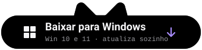
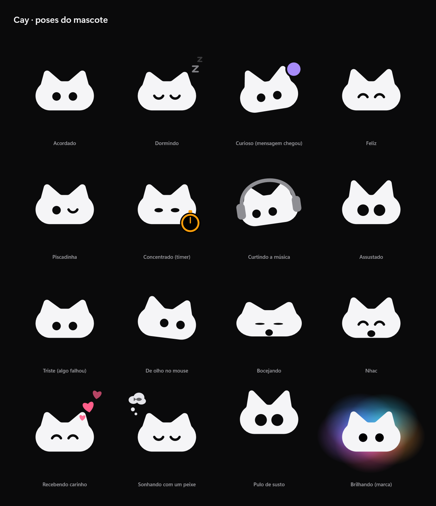

 

**[Site](https://nextchat.nextsistem.dev.br/cay) · [Baixar](https://github.com/Rudhery/cay/releases/latest) · [English](#english)**

 

O **Cay** é uma ilha dinâmica nativa para Windows: uma pílula preta colada no topo da tela que mostra o que importa
agora. A música que está tocando, a mensagem que chegou, o alerta do seu trabalho. Passe o mouse e ela se abre com uma
mola; tire e ela volta a ser pílula. Some em tela cheia e nunca rouba o foco.

E lá em cima mora um gato: os dois-pontos da hora viraram os olhos dele.

## O que ele faz

- **Música de qualquer player** (Spotify, YouTube no navegador, Apple Music, VLC…): capa, letra sincronizada estilo
  karaokê, barras que ouvem o som de verdade, controles e volume só do app que toca.
- **Notificações** com resposta, e **NextChat** direto na ilha.
- **Busca estilo Spotlight** (`Win+Alt+Espaço`): apps, arquivos, contas, conversões, copiados e timer com nome
  ("10 min café").
- **Prateleira de arquivos** com Quick Look, **histórico de copiados**, **conta-gotas**, **prévia do print** com cópia
  do texto, **nota rápida**.
- **Timer e Pomodoro**, **próxima reunião** pela agenda, **chamada em andamento**, **downloads do navegador**,
  **builds do GitHub** e **site vigiado** ao vivo.
- **Volume, Bluetooth, bateria, microfone e câmera em uso**, **não perturbe**, **clima**.
- **Modo fio**: sobre janela maximizada, a ilha vira uma alça fina (ou só nos apps que você escolher).
- **Personalização**: material sólido, fumê ou vidro, cor de destaque, inglês ou português.

## O gato

Ele dorme ao lado da hora, acorda quando você chega, inclina a cabeça quando chega mensagem, dança com a música,
ronrona com carinho do mouse, come o arquivo que vai para a prateleira, sonha com um peixe de noite e põe abóbora no
Halloween. Cinco cliques rápidos nele e veja o que acontece.

## Instalando

Baixe na [última versão](https://github.com/Rudhery/cay/releases/latest):

| Arquivo | Para quem |
|---|---|
| **`Rudhery.Cay-win-Setup.exe`** (~65 MB) | todo mundo: já traz tudo o que precisa |
| `Rudhery.Cay-leve-Setup.exe` (~20 MB) | quem já tem o .NET 10 Desktop Runtime (o instalador baixa se faltar) |

Requer **Windows 10 (2004) ou 11**. O Cay se atualiza sozinho: quando sai uma versão nova, baixa em segundo plano e
aplica na próxima vez que fechar.

**Privacidade:** o Cay não manda nada sobre você para lugar nenhum. Ele só acessa a internet para o clima
(Open-Meteo, e ipwho.is para estimar a cidade quando a localização do Windows está desligada), a letra das músicas
(LRCLIB), o que você conectar (agenda, NextChat, site vigiado, GitHub) e para procurar atualização aqui no GitHub. O conteúdo copiado nunca sai do computador.

## Atalhos

| Atalho | O que faz |
|---|---|
| `Win+Alt+C` | normal → fio → oculta |
| `Win+Alt+Espaço` | busca |
| `Win+Alt+N` | nota rápida |
| `Win+Alt+V` | histórico de copiados |
| `Win+Alt+T` | Pomodoro, pausar e continuar |
| `Win+Shift+C` | conta-gotas |

Botão direito na ilha ou no gato da bandeja: configurações, modo fio, letra das músicas, monitor e mais.

## Problemas e ideias

Abra uma [issue](https://github.com/Rudhery/cay/issues). Se o Cay fechou sozinho, ele guarda um relatório em
`%LOCALAPPDATA%\Cay\falhas` (o botão **Logs e relatórios de falha** em Configurações › Sobre abre a pasta): anexe na issue.

## Licença

O Cay é **gratuito** para uso pessoal e comercial. O código-fonte não é distribuído. Veja [LICENSE](LICENSE).

---

## English

**Cay** is a native dynamic island for Windows: a black pill glued to the top of the screen that shows what matters
right now (the song that's playing, the message that just arrived, your build's progress) with a cat that lives up
there. Download the [latest release](https://github.com/Rudhery/cay/releases/latest) (`Rudhery.Cay-win-Setup.exe`).
Windows 10 (2004) or 11. Free to use; the source code is not distributed. The app speaks English or Portuguese
(automatic from Windows).
